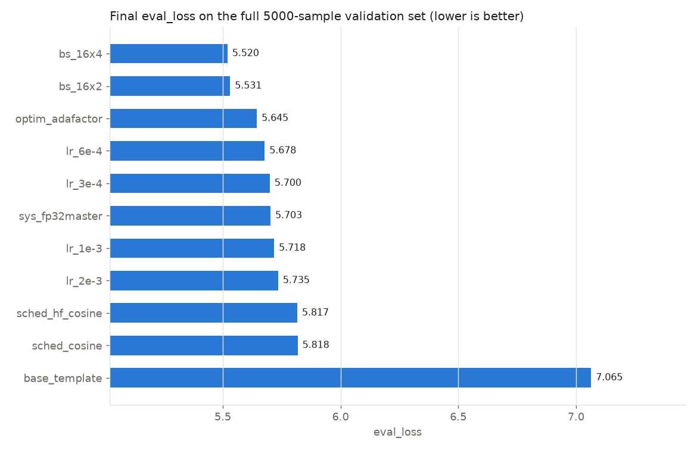
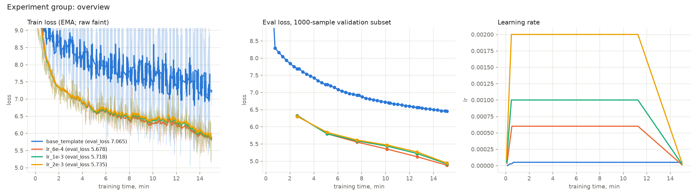
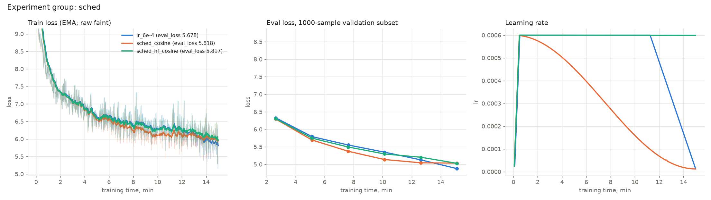
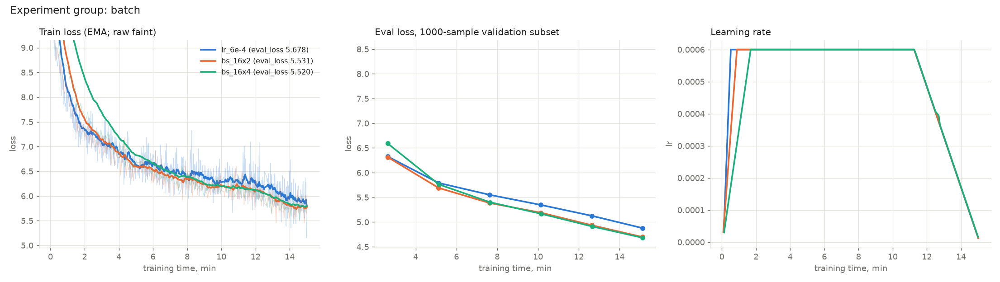
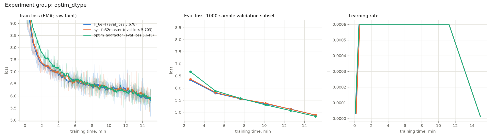

# HW1: мини-претрейн Qwen3-1B на русской Википедии за 15 минут

**Итог:** лучшим раном стал eval_loss = **5.520** (perplexity 250) на полной валидации из 5000 документов
(AdamW, lr 6e-4, эффективный батч 64 = 16 × gradient accumulation 4, WSD-расписание по времени, bf16, torch.compile);
бейзлайн с гиперпараметрами шаблона на том же железе = 7.065 (perplexity 1170). За те же 15 минут модель обработала
19.6м токенов обучающего текста (без учета паддинга) вместо 6.3M, т.е. около 3% одной эпохи.

**Про железо.** Замеры скорости и первая серия экспериментов сделаны на A100 80GB, но доступ к ВМ закрылся, так что логи и графики с нее не сохранились. Цифры по A100 взяты из логов, снятых во время работы. Финальные 15 минутные раны выполнены на RTX 5090 32GB, ограничение по времени то же (TimeoutCallback), модель, данные и разбиение те же.

## Файлы

| файл | назначение |
|---|---|
| [your_solution.py](your_solution.py) | решение: подготовка данных, модель, обучение, финальный eval, генерации |
| [benchmark.py](benchmark.py) | проверка корректности padding-free, замеры пропускной способности, разбор NaN (replay) |
| [run_experiments.sh](run_experiments.sh) | план экспериментов по стадиям |
| [plot_losses.py](plot_losses.py) | графики лоссов и таблица результатов |
| [generate.py](generate.py) | генерации обученной модели по своим промптам |
| [report/](report/) | графики и таблица результатов финальных ранов |
| [results/](results/) | run_summary.json (конфиг, метрики, генерации) и trainer_state.json (история лоссов) каждого рана, логи |
| [RUNBOOK.md](RUNBOOK.md) | как воспроизвести: окружение (Docker или venv под разные драйверы), данные, эксперименты, генерации |

## Сетап

- Данные: **wikimedia/wikipedia, 20231101.ru** (1 945 063 документа), валидация состоит из первых 5000, остальные ушли на train.
- Токенизатор **ai-forever/rugpt3small_based_on_gpt2**, блоки фиксированной длины 512 (truncation + padding), **pad = eos**
- Модель: Qwen3, hidden 2048, 12 слоев, 16 голов (8 KV), MLP 8192, 960 881 664 параметра, инициализация с нуля,
  FlashAttention-2, bf16.
- Обучение 15 минут (TimeoutCallback), время компиляции и промежуточных eval входит в эти 15 минут.

## Ключевая идея

Времени мало, поэтому важно потратить 15 минут на как можно большее число полезных токенов и правильно распорядиться learning rate за это время.

### Пропускная способность

1. **torch.compile**: слияние поэлементных операций в общие ядра (+41% на A100, раздел "Системные замеры").
2. **Eval по времени и на подвыборке.** Промежуточная оценка происходит каждые 150с на первых 1000 валидационных
   документах (eval_subset_loss, окрло 7 с), финальная — на всех 5000 (eval_loss). Полная валидация каждые 100 шагов
   съела бы заметную часть бюджета.
3. **Без промежуточных чекпоинтов.** Сохранение модели 1B вместе с оптимизатором (~ 5.4 GB) каждые 100 шагов отнимает время у обучения. Лосс к концу еще падает, так что последние веса и есть лучшие, их сохраняет TimeoutCallback.
4. Fused AdamW, `use_cache=False` при обучении (KV-кэш не нужен), bf16.
5. **Padding-free батчи** (документы склеиваются в одну последовательность без паддинга) дают еще +28–39%, но в этом
   режиме обучение расходится в NaN (раздел "Padding-free и NaN"), поэтому в финальных ранах используются обычные
   батчи с паддингом.

### Расписание LR по времени

Стандартные расписания HF считают длину обучения в шагах эпохи (примерно 120k шагов при bs 16), а за 15 минут успевается около 3 300 шагов, поэтому cosine/linear почти не успели бы опустить LR, и отжига в конце не было бы. TimeBudgetTrainer использует расписание, в котором прогресс измеряется долей прошедшего времени от 15 минут (WSD). Сначала LR линейно растет в течение 100 шагов, затем держится постоянным, а в последние 25% времени линейно снижается до 2% от пикового значения. LR опускается к моменту остановки при любой пропускной способности. Доступны также расписания cosine, linear и constant, которые тоже работают по времени.

### Лосс и метки

labels = input_ids, но паддинг замаскирован (-100), кроме первого pad-токена, так как pad = eos, он учит модель
заканчивать документ. Первый токен документа тоже замаскирован (его не из чего предсказывать). Без маскирования модель
тратила бы емкость на предсказание "eos после eos", а eval_loss был бы искусственно занижен за счет тривиальных
токенов. Поэтому eval_loss здесь считается только по реальным токенам и может быть выше, чем в решениях, где
паддинг входит в лосс.

## Эксперименты (на RTX 5090)

Опорная конфигурация: padded-батчи, bs 16, torch.compile, fused AdamW (бета-2 = 0.95, weight decay 0.1, grad clip 1.0),
веса в bf16, WSD по времени, warmup 100 шагов, lr 6e-4. Каждый ран меняет одну вещь относительно нее.
На графиках показан лосс от времени обучения, при разных batch size и скорости шаги несопоставимы.

| ран | что изменено | **eval_loss** | perplexity | шагов | токенов | ток/с |
|---|---|---|---|---|---|---|
| **bs_16x4** | эффективный батч 64 (grad accumulation 4) | **5.520** | **250** | 877 | 19.6M | 21 560 |
| bs_16x2 | эффективный батч 32 (grad accumulation 2) | 5.532 | 253 | 1 715 | 19.2M | 21 092 |
| optim_adafactor | Adafactor вместо AdamW | 5.645 | 283 | 2 961 | 16.5M | 18 211 |
| lr_6e-4 | — (опорный) | 5.678 | 292 | 3 279 | 18.3M | 20 161 |
| lr_3e-4 | lr 3e-4 | 5.700 | 299 | 3 287 | 18.4M | 20 218 |
| sys_fp32master | fp32 master weights | 5.703 | 300 | 3 032 | 16.9M | 18 622 |
| lr_1e-3 | lr 1e-3 | 5.718 | 304 | 3 287 | 18.4M | 20 215 |
| lr_2e-3 | lr 2e-3 | 5.735 | 310 | 3 287 | 18.4M | 20 216 |
| sched_hf_cosine | cosine HF на всю эпоху | 5.817 | 336 | 3 287 | 18.4M | 20 219 |
| sched_cosine | cosine по времени | 5.818 | 336 | 3 287 | 18.4M | 20 215 |
| base_template | гиперпараметры шаблона (bs 4, lr 5e-5, …) | 7.065 | 1170 | 4 502 | 6.3M | 6 922 |

Perplexity за 15 минут знаительно снижается. На первых шагах train loss около 11,1, то есть perplexity примерно
65 000, а это уровень случайного угадывания из всего словаря (ln 50 257 = 10.8). К концу лучшего рана eval_loss
равен 5,52 и perplexity 250, то есть модель в среднем выбирает следующий токен примерно из 250 вариантов вместо
50 тысяч.

eval_subset_loss ниже обозначает промежуточную оценку на первых 1000 документах валидации, которая проводится примерно каждые 2.5 минуты. Эта подвыборка "легче" полной валидации примерно на 0,6-0,8 (опорный ран: 4,88 против 5.68; бейзлайн: 6,46 против 7,07), потому что самые ранние статьи Википедии длинные и написаны типичным языком. Поэтому промежуточные кривые годятся для сравнения ранов между собой, а итоговой метрикой служит eval_loss на всех 5000 документах.

### 1. Бейзлайн шаблона и learning rate

| lr | 2.5 мин | 5 | 7.5 | 10 | 12.5 | 15 | `eval_loss` |
|---|---|---|---|---|---|---|---|
| 3e-4 | 6.379 | 5.770 | 5.498 | 5.286 | 5.075 | 4.902 | 5.700 |
| **6e-4** | 6.327 | 5.791 | 5.551 | 5.347 | 5.126 | 4.877 | **5.678** |
| 1e-3 | 6.318 | 5.795 | 5.586 | 5.434 | 5.220 | 4.917 | 5.718 |
| 2e-3 | 6.297 | 5.836 | 5.610 | 5.467 | 5.265 | 4.939 | 5.735 |

- **Бейзлайн проигрывает по обеим осям:** втрое меньше токенов (маленький батч, паддинг, запись чекпоинта 5.4 ГБ
  каждые 100 шагов) и слишком маленький LR. Его train loss очень шумный: при bs 4 шаг видит только 1,4к токенов.
  На A100 тот же бейзлайн дал 7,3 (4,2м токенов), вероятно из-за более медленного диска, чекпоинты сохранялись дольше.
- **LR: U-образная зависимость с минимумом около 6e-4**, но разброс небольшой (5.68–5.74 на 3e-4…2e-3).
  Больший LR быстрее стартует (на 2,5 минуте 2e-3 лучше всех), меньший LR лучше в середине (3e-4 лидирует
  с 5-й по 12.5-ю минуту), а на отжиге выигрывает 6e-4.

### 2. Расписание LR

| расписание (lr 6e-4) | 2.5 мин | 5 | 7.5 | 10 | 12.5 | 15 | `eval_loss` |
|---|---|---|---|---|---|---|---|
| **WSD по времени** (спад в последние 25%) | 6.327 | 5.791 | 5.551 | 5.347 | 5.126 | **4.877** | **5.678** |
| cosine по времени | 6.293 | 5.695 | 5.373 | 5.137 | 5.043 | 5.034 | 5.818 |
| cosine HF на всю эпоху | 6.302 | 5.748 | 5.494 | 5.295 | 5.202 | 5.028 | 5.817 |

- **Стандартный cosine HF рассчитан на 121к шагов эпохи**, за 15 минут LR почти не снижается (на графике LR это
  горизонтальная линия), отжига нет, итог на 0.14 хуже WSD.
- **Cosine по времени лидирует почти все время** (на 10й минуте 5,14 против 5,35 у WSD), потому что LR
  снижается раньше, но последние 5 минут проводит на маленьком LR (< 1.6e-4) и почти перестает улучшаться. 
  WSD держит пиковый LR 75% времени, затем быстрый спад дает −0.25 за последние 2,5 минуты
  и обгоняет оба варианта.

### 3. Batch size и gradient accumulation

| эффективный батч (lr 6e-4) | шагов | ток/с | 2.5 мин | 5 | 10 | 15 | `eval_loss` |
|---|---|---|---|---|---|---|---|
| 16 | 3 279 | 20 161 | 6.327 | 5.791 | 5.347 | 4.877 | 5.678 |
| 32 (16 × 2) | 1 715 | 21 092 | 6.314 | 5.691 | 5.190 | 4.697 | 5.532 |
| **64 (16 × 4)** | 877 | 21 560 | 6.592 | 5.763 | 5.167 | **4.682** | **5.520** |

- **Больший эффективный батч заметно лучше**, хотя шагов оптимизатора в 2-4 раза меньше. Батч 16 слишком шумный для этой модели: оценка
  градиента точнее с большим батчем, и при том же LR шаг полезнее.
- **Пропускная способность тоже растет** (+5–7%): шаг оптимизатора и обнуление градиентов выполняются реже.
  Батч 32 без accumulation не помещается в 32 GB (OOM), gradient accumulation решает это без потери скорости.
- Warmup задан в шагах оптимизатора, поэтому при accumulation 4 он длится около 1,7 минуты вместо 0,5,
  отсюда отставание bs 64 на 2й минуте. LR для большего батча отдельно не подбирался: возможно, батчу 64 нужен
  больший LR.

### 4. Оптимизатор и точность весов

| вариант (lr 6e-4, bs 16) | ток/с | токенов | пик памяти | `eval_loss` |
|---|---|---|---|---|
| AdamW (fused), веса bf16 | 20 161 | 18.3M | 17.5 GB | 5.678 |
| **Adafactor**, веса bf16 | 18 211 | 16.5M | 13.9 GB | **5.645** |
| AdamW, fp32 master weights + bf16 autocast | 18 622 | 16.9M | 23.9 GB | 5.703 |

- **Adafactor** медленнее на 10%, стартует хуже (6,7 против 6,3 на 2.5 минуте), но с 10й минуты обгоняет AdamW и
  заканчивает лучше, занимая на 3,6 ГБ меньше памяти (факторизованные вторые моменты, без момента первого порядка).
  Но LR подбирался для AdamW, у Adafactor другая шкала шага, так что честное сравнение требует отдельного
  перебора LR.
- **fp32 master weights** не улучшают качество: кривые почти совпадают с bf16, а из-за −8% скорости модель видит
  меньше токенов и заканчивает чуть хуже. На коротком обучении с lr 6e-4 обновления весов достаточно крупные,
  чтобы не теряться в округлении bf16.

Не сделано из-за ограниченного GPUвремени: сочетание лучших находок (батч 64 + Adafactor), подбор LR для большого
батча, разбор причины NaN в padding-free режиме.

## Генерации

Лучший ран (bs_16x4), 80 новых токенов: greedy с repetition_penalty 1,2 и сэмплирование (T = 0.8, top-k 50,
top-p 0.95, repetition_penalty= 1.2). Все генерации каждого рана лежат в results/runs/<ран>/run_summary.json.

> **Река Волга** — деревня в Новосельском районе Псковской области России. Входит в состав сельского поселения
> "Село Солино". География: Деревня находится на юге центральной части Калужской области, в зоне
> хвойно-широколиственных лесов, при автодороге, на расстоянии примерно 16 километров (по прямой) к юго-востоку от
> города Данилова… *(greedy)*

> **В 1812 году** был назначен начальником штаба 1-го стрелкового корпуса. Служил в Санкт-Петербургском полку, где
> командовал 3-м пехотным полком (с 1808 года). В 1816 году произведен в генерал-майоры и с 1809 года — в
> подполковники. С 1810 по 1811 год служил в русско-турецкой войне… *(greedy)*

> **Александр Сергеевич Пушкин родился** в городе Ново-Амуречье, Россия. Биография: Родился в семье рабочего.
> Окончил среднюю школу № 3. В 1940 году окончил Московский институт физической культуры и спорта. С 1939 года
> работал на заводе № 1 по специальности инженер-механика. В 1941 году был призван на службу… *(greedy)*

> **Москва — столица**, находящееся в нем здание села Чернянское. История: В 1558 году храм был образован… Согласно
> Списку населенных мест Самарской губернии 1769 года деревня вошла в состав Волховского уезда Санкт-Петербургской
> губернии… *(сэмплирование)*

> **Математика — это** неорганическое соединение, но и в качестве субстрата. Впервые термин "Психология" (1920)…
> Примечания. Литература… *(greedy)*

Для сравнения — бейзлайн шаблона:

> **Александр Сергеевич Пушкин родился** (1973—19839) — советский и российский футболист, Герой Советского Союза.
> Биография: Родился в селе Великой Отечественной войны. В 1813 году окончил за "За отвагу"…

> **Математика — это** в городе, а также и на территории. История: В селе года была построена в состав города…

Что видно:
- Модель выучила жанры и шаблоны Википедии: статья о населенном пункте, военная биография 19 века (чины, полки, войны), советская биография, разделы "История", "Примечания", "Литература".
- По сравнению с опорным раном (bs 16) тексты местами связнее: на "В 1812 году" опорный ран зацикливался
  ("— епископом Русской православной церкви" × 4), а лучший ран пишет связную военную биографию с полками,
  генерал-майорами и русско-турецкой войной.
- **Знаний о мире нет:** Волга стала деревней, Пушкин — это инженер-механик, внутри одной статьи путаются области и даты
  (произведен в генерал-майоры в 1816, в подполковники с 1809). Но для 20м токенов и 15 минут это ожидаемо.
- Greedy декодирование иногда скатывается в повторы (пустые строки после "Литература"), сэмплирование разнообразнее.
- Генерации бейзлайна заметно хуже: обрывки шаблонов, несуществующие даты (1973—19839), рассогласованные фразы.

### Промпты с более редкими сущностями

> **Кукрыниксы —** деревня в Кызылском районе Псковской области России. Входит в состав сельского поселения
> "Село Скирново". География: Деревня находится на юге центральной части Калужской области, в зоне
> хвойно-широколиственных лесов, при автодороге, на расстоянии примерно 16 километров (по прямой) к юго-востоку от
> города Данилова… Абсолютная высота — 172 метра над уровнем моря. *(greedy)*

> **ГОЭЛРО́ (сокр. от "Госуда́рственная коми́ссия по электрифика́ции Росси́и") —** советский и российский ученый,
> доктор физико-математических наук, профессор… Биография: Родился в 1875 году в городе Тверь. В 1909—1940 годах
> учился в Дерптском университете. С 1924 года работал на кафедре органической химии… В 1932 году был избран
> членом-корреспондентом РАН. *(greedy)*

> **Смешарики — это** неорганическое соединение, но и для получения их применения. Виды. Наиболее известные
> виды: *(greedy)*

> **Смешарики — это** место, состоящая из девяти государств в США… В мае 2010 года, когда Германия была объявлена
> между двумя странами после окончания университета, в ходе церемонии открытия выборов было создано несколько
> дней… *(сэмплирование)*

- Модель одинаково не знает ни частых, ни редких сущностей. За 15 минут она прочитала около 3% одной эпохи и выучила только форму текста. 
  Поэтому шаблон она выбирает по тому, как выглядит промпт, а не по смыслу имени
- **Пробел в конце промпта ломает генерацию.** Те же промпты с пробелом после тире ("кукрыниксы — ",
  "ГОЭЛРО… — ") дали перенос строки с зацикливанием "России, России, России" и двойное тире. Причина в BPE токенизаторе,
  в обучающих текстах пробел почти всегда склеен со следующим словом в один токен (например " деревня", " советский"), так
  что одиночный пробел в конце промпта модели практически не встречался.
- Greedy держит шаблон, сэмплирование с T = 0.8 быстро теряет связность.

## Системные замеры скорости (A100)

Короткие замеры на A100 80GB PCIe (55 шагов, считаются только токены с меткой). За базу взята конфигурация
padding-free, bs 16, fused AdamW, веса bf16, без torch.compile.

| конфигурация | токенов/с | к базе | пик памяти, GB |
|---|---|---|---|
| база (padding-free, bs 16, без compile) | 21 295 | | 19.8 |
| **+ torch.compile** | **30 001** | **+41%** | 15.5 |
| padded-батчи, без compile / с compile | 15 343 / 23 525 | −28% / +10% | 22.2 / 16.4 |
| bs 32 / bs 64 | 22 453 / 22 905 | +5% / +8% | 31.6 / 55.7 |
| AdamW foreach вместо fused | 19 734 | −7% | 19.8 |
| Adafactor | 16 804 | −21% | 16.2 |
| fp32 master weights (с tf32 и без одинаково) | 18 652 | −12% | 28.4 |

- **torch.compile** дает +41% скорости и экономит 22% памяти. Компиляция занимает около 39 с внутри 15 минут и
  многократно окупается.
- **Padding-free** дает +39% без compile и +28% с ним, так как паддинг занимает 31,7 % батча. Но этот режим приводил
  к NaN (см. ниже).
- **Fused AdamW** на 8 % быстрее foreach реализации. fp32 master weights стоят 12% скорости и 8.6 ГБ памяти,
  а tf32 ни на что не влияет, потому что под bf16 autocast матричные умножения идут в bf16.

## Padding-free и NaN (A100)

В режиме padding-free все пять ранов перебора LR разошлись в NaN (при lr 4e-3 примерно на 20-м шаге, при 3e-4
примерно на 540-м). На слишком большой LR это не похоже, потому что grad_norm перед сбоем держался около 1 и сразу
становился NaN, а padded-батчи с теми же LR обучались стабильно, в том числе во всех 11 ранах на RTX 5090. Абляция
на 300 шагах при lr 6e-4 показала, что NaN остается без torch.compile и с fp32 master weights и исчезает только
с padded-батчами.

Значит, сбой связан со склейкой документов (FlashAttention-2 varlen). Forward pass на необученной модели совпадает
с padded до бита, поэтому NaN, скорее всего, возникает именно в forward pass, но строго это не доказано. Точную
причину найти не успела (инструменты разбора описаны в [RUNBOOK.md](RUNBOOK.md), раздел "Диагностика"), поэтому
в коде padding_free=False по умолчанию.

## Выводы

1. **При ограниченном времени делаем упор на пропускной способности и размере батча.** Оптимизированная конфигурация
   обрабатывает 19.6M токенов против 6.3M у шаблона, а eval_loss падает с 7.07 до 5.52 (perplexity 1170 --> 250).
   Основной вклад дал больший батч, torch.compile и отказ от сохранения чекпоинтов каждые 100 шагов.
2. **Эффективный батч важнее числа шагов.** Батч 32–64 (через gradient accumulation) лучше батча 16 на 0.15, хотя шагов
   в 2–4 раза меньше; дальше 32 отдача мала.
3. **LR около 6e-4** (U-образная зависимость на 3e-4…2e-3, разброс ~0.06). LR шаблона (5e-5) на порядок мал.
4. **Расписание нужно привязывать к бюджету времени.** HF-расписание на эпоху за 15 минут не снижает LR вовсе,
   cosine по времени снижает слишком рано; WSD (долго пиковый LR, быстрый спад в конце) лучше обоих на 0.14.
5. **Adafactor** при том же LR оказался чуть лучше AdamW (5.65 против 5.68) и экономнее по памяти;
   **fp32 master weights** качества не добавляют, только замедляют.
6. **Padding-free — самый большой "бесплатный" выигрыш по скорости (+28–39%), но в связке с FlashAttention-2 varlen
   он приводил к NaN в градиентах**, скорее всего возникавшему в forward pass, независимо от compile и точности
   весов. Корректность прямого прохода не гарантирует корректность обучения; без абляции эту проблему легко принять
   за "слишком большой LR".
7. **torch.compile** дает +41% и экономит память, но на старом драйвере требует обходного пути (ptxas из CUDA 11.8),
   а при меняющейся длине батча — аккуратной работы с динамическими формами, иначе перекомпиляции съедают выигрыш.
