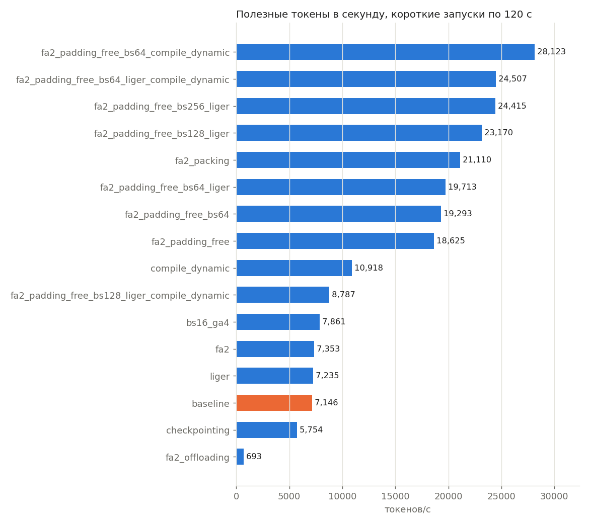
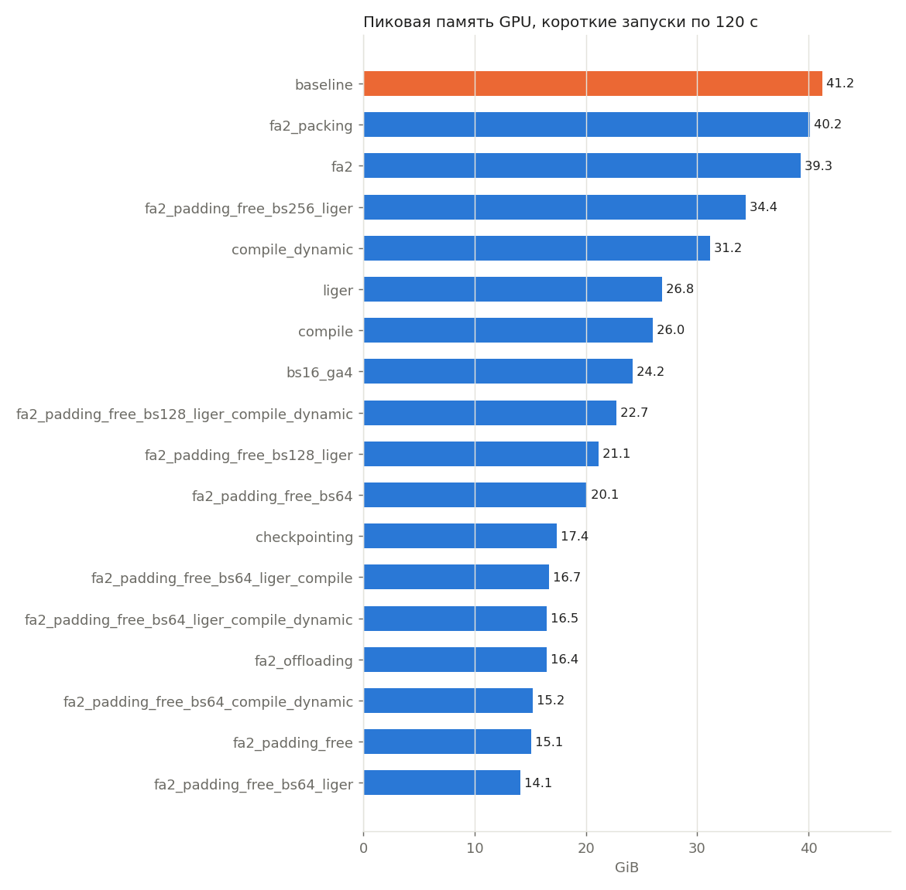

# ДЗ 2. Ускорение обучения на одной GPU и кольцевые коммуникации

## Итог

Итоговая конфигурация это FlashAttention2, padding free с микробатчем 256 примеров без gradient accumulation и
torch.compile с динамической длиной батча. Она дает 29 003 полезных токенов в секунду против 6 885 у
бейзлайна, **S = 4.21**. Val loss после 5 минут тоже лучше бейзлайна (6,064 против 6,641).

Больше всего дает отказ от паддинга (в 2,6 раза), еще примерно в 1,6 раза сверху добавляют больший микробатч и
torch.compile, которому пришлось помочь не перекомпилироваться на каждом шаге.

Кольцевые reduce-scatter, all-gather и all-reduce реализованы в [communications.ipynb](communications.ipynb)
и [collectives.py](collectives.py), вывод проверок курса на 2 и 4 процессах сохранен в ноутбуке.

## Сетап

- Модель Qwen3 на 0.96B параметров (hidden 2048, 12 слоев, 16 голов внимания, 8 KV-голов, MLP 8192),
  каждый запуск с нуля.
- Данные и разбиение как в шаблоне train.py. Абзацы первых 50 500 статей русской Википедии (244 768 примеров
  в train), валидация из абзацев первых 500 статей, токенизатор ai-forever/rugpt3small_based_on_gpt2,
  максимальная длина 512.
- Не меняются длина последовательности, bf16, оптимизатор AdamW (fused), learning rate 3e-4,
  constant_with_warmup с 200 шагами разогрева, seed 42 и подсчет метрик.
- Одна GPU NVIDIA A100 80GB PCIe, драйвер 470.182.03 (CUDA 11.4), Ubuntu 22.04, Python 3.10.12. Библиотеки
  torch 2.6.0+cu118, flash-attn 2.7.3, triton 3.2.0, transformers 4.56.2, trl 0.23.1, datasets 3.6.0,
  accelerate 1.6.0, liger-kernel 0.6.2. Docker на ВМ нет, окружение собрано в venv. Драйвер 470 не загружает ядра,
  которые Triton собирает ptxas из CUDA 12, поэтому TRITON_PTXAS_PATH указывает на ptxas из
  nvidia-cuda-nvcc-cu11==11.8.89. Без этого не работают ни torch.compile, ни Liger.
- Главной метрикой считаем tokens_per_second из summary.json, то есть полезные токены (позиции с меткой, паддинг
  не считается) в секунду без первых 10 шагов оптимизатора, на которых идет разогрев и компиляция.
- Все запуски, включая бейзлайн и итоговый, шли на одной и той же GPU в один день.

## Конфигурации

Каждая конфигурация меняет только настройки скорости. Таблица EXPERIMENTS в train.py задает отличия от
настроек шаблона (TEMPLATE_SPEED_CONFIG), значения по умолчанию в TRAINING_CONFIG и
ATTENTION_IMPLEMENTATION  соответствуют итоговой конфигурации. Всего 25 конфигураций, включая бейзлайн.

Короткие запуски шли по 120 секунд(не по 60 или 90). `torch.compile` тратит на компиляцию от 60 до 110 секунд,
и при 90 секундах на замер почти не остается шагов. Итоговые запуски по 300 секунд.

Проверенные механизмы

- FlashAttention2 вместо SDPA (fa2).
- Liger kernels, то есть RMSNorm, SwiGLU, RoPE и fused linear cross-entropy (liger).
- torch.compile (compile, compile_dynamic).
- Batch size и gradient accumulation (bs16_ga4, bs64_ga1, микробатчи 64, 128 и 256 при padding-free).
- Activation checkpointing и activation offloading.
- Padding-free и sequence packing.
- Сочетания, например padding-free с Liger, padding-free с compile, packing с Liger и compile.

Padding-free и packing должны дать больше всего. В данных шаблона примеры короткие, в среднем 91 токен,
медиана 73, 90% короче 167 токенов. Батч из 32 примеров дополняется паддингом до самого длинного (в среднем
до 283 токенов), поэтому около 65% вычислений бейзлайна приходится на паддинг. Без паддинга микробатч из 32
примеров содержит только около 2 900 токенов, поэтому отдельно проверяются padding-free с микробатчами 64, 128
и 256 примеров (около 5 800, 11 600 и 23 000 токенов).

Padding-free и packing корректны только с FlashAttention2, так как только он получает границы документов через
position_ids и не дает токенам видеть соседние примеры. С SDPA TRL лишь предупреждает, и документы смешиваются,
поэтому эти механизмы проверяются только вместе с FlashAttention2.

### torch.compile без перекомпиляций

Из коробки torch.compile здесь почти бесполезен. Длина батча меняется на каждом шаге (при паддинге это длина
самого длинного примера, при padding-free сумма длин), и на каждую новую длину уходит новая компиляция примерно
за 30 секунд. За 208 секунд конфигурация compile успела сделать 3 шага оптимизатора, а padding-free с Liger
и compile за 131 секунду сделала 9 шагов. Кроме того, при padding-free TRL передает в модель только
position_ids, и transformers в каждом из 12 слоев внимания заново вычисляет границы документов через .item(),
что разрывает граф.

Конфигурации с суффиксом compile_dynamic (флаг COMPILE_DYNAMIC в train.py) устраняют обе причины.

- Перед каждым шагом длина батча помечается динамической через torch._dynamo.maybe_mark_dynamic, и граф сразу
  компилируется под произвольную длину.
- При padding-free коллатор VarlenCollator (наследник коллатора TRL) сразу считает cu_seq_lens и
  max_length, и модель идет в varlen ветку Flash Attention2 без вычислений, зависящих от данных. Выход
  коллатора поэлементно совпадает с коллатором TRL, а границы совпадают с теми, что transformers вычисляет сам.

Модель, данные и подсчет метрик от этого не меняются. Компиляция почти всегда укладывается в первые 10 шагов,
которые в tokens_per_second не входят. В итоговых запусках выбросов времени шага после разогрева нет.

## Результаты

### Итоговые запуски по 300 секунд

| конфигурация | настройки | токенов/с | ускорение | токенов/с с разогревом | пик памяти, GiB | val loss | шагов | с/шаг |
|---|---|---|---|---|---|---|---|---|
| baseline | шаблон, SDPA, bs 32×2 | 6 885 | 1.00× | 6 842 | 41.2 | 6.641 | 361 | 0.826 |
| final | итоговый train.py, FA2, padding-free, bs 256×1, compile дин. | 29 003 | 4.21× | 21 065 | 39.8 | 6.064 | 276 | 0.792 |
| fa2_padding_free_bs256_compile_dynamic | то же через EXPERIMENT, повтор | 28 666 | 4.16× | 20 518 | 39.8 | 6.138 | 269 | 0.801 |
| fa2_padding_free_bs128_compile_dynamic | FA2, padding-free, bs 128×1, compile дин. | 27 629 | 4.01× | 19 881 | 23.9 | 5.341 | 521 | 0.415 |
| fa2_padding_free_bs64_compile_dynamic | FA2, padding-free, bs 64×1, compile дин. | 26 426 | 3.84× | 19 175 | 15.4 | 5.097 | 1005 | 0.217 |
| fa2_padding_free_bs256_liger | FA2, padding-free, bs 256×1, Liger | 23 848 | 3.46× | 23 776 | 34.6 | 5.751 | 311 | 0.963 |

**S = 29 003 / 6 885 = 4.21.** Итоговая конфигурация запускалась дважды, через train.py с настройками по
умолчанию (final) и через EXPERIMENT=fa2_padding_free_bs256_compile_dynamic, скорость отличается на
1.2%. S считается по запуску final, то есть по сдаваемому train.py.

### Короткие запуски по 120 секунд

| конфигурация | настройки | токенов/с | ускорение | токенов/с с разогревом | пик памяти, GiB | val loss | шагов | с/шаг |
|---|---|---|---|---|---|---|---|---|
| baseline | шаблон, SDPA, bs 32×2 | 7 146 | 1.00× | 7 017 | 41.2 | 7.928 | 149 | 0.794 |
| fa2 | FlashAttention2 | 7 353 | 1.03× | 7 231 | 39.3 | 7.909 | 153 | 0.771 |
| liger | Liger | 7 235 | 1.01× | 6 803 | 26.8 | 7.945 | 144 | 0.784 |
| compile | torch.compile | нет замера | | 89 | 26.0 | 11.234 | 3 | |
| compile_dynamic | torch.compile, динамическая длина | 10 918 | 1.53× | 2 908 | 31.2 | 8.387 | 62 | 0.513 |
| bs16_ga4 | bs 16×4 | 7 861 | 1.10× | 7 739 | 24.2 | 7.826 | 164 | 0.722 |
| bs64_ga1 | bs 64×1 | упал (нехватка памяти (OOM)) | | | | | | |
| checkpointing | activation checkpointing | 5 754 | 0.81× | 5 636 | 17.4 | 8.093 | 119 | 0.989 |
| offloading | activation offloading | упал (ошибка SDPA, attn_bias не выровнен) | | | | | | |
| fa2_offloading | FA2, activation offloading | 693 | 0.10× | 607 | 16.4 | 11.196 | 13 | 7.797 |
| fa2_padding_free | FA2, padding-free, bs 32×2 | 18 625 | 2.61× | 18 473 | 15.1 | 6.485 | 389 | 0.306 |
| fa2_padding_free_bs64 | FA2, padding-free, bs 64×1 | 19 293 | 2.70× | 19 143 | 20.1 | 6.463 | 403 | 0.296 |
| fa2_packing | FA2, packing, bs 32×2 | 21 110 | 2.95× | 20 969 | 40.2 | 8.124 | 79 | 1.516 |
| fa2_padding_free_bs64_liger | FA2, padding-free, bs 64×1, Liger | 19 713 | 2.76× | 19 120 | 14.1 | 6.462 | 403 | 0.289 |
| fa2_padding_free_bs128_liger | FA2, padding-free, bs 128×1, Liger | 23 170 | 3.24× | 22 609 | 21.1 | 6.841 | 238 | 0.494 |
| fa2_padding_free_bs256_liger | FA2, padding-free, bs 256×1, Liger | 24 415 | 3.42× | 23 919 | 34.4 | 7.776 | 126 | 0.941 |
| fa2_padding_free_bs64_liger_compile | FA2, padding-free, bs 64×1, Liger, compile | нет замера | | 395 | 16.7 | 11.220 | 9 | |
| fa2_packing_liger_compile | FA2, packing, Liger, compile | упал (NaN в loss) | | | | | | |
| fa2_padding_free_bs64_liger_compile_dynamic | FA2, padding-free, bs 64×1, Liger, compile дин. | 24 507 | 3.43× | 12 478 | 16.5 | 7.117 | 264 | 0.232 |
| fa2_padding_free_bs128_liger_compile_dynamic | FA2, padding-free, bs 128×1, Liger, compile дин. | 8 787 | 1.23× | 2 499 | 22.7 | 10.538 | 27 | 1.259 |
| fa2_padding_free_bs256_liger_compile_dynamic | FA2, padding-free, bs 256×1, Liger, compile дин. | упал (NaN в loss) | | | | | | |
| fa2_packing_liger_compile_dynamic | FA2, packing, Liger, compile дин. | упал (NaN в loss) | | | | | | |
| fa2_padding_free_bs64_compile_dynamic | FA2, padding-free, bs 64×1, compile дин. | 28 123 | 3.94× | 2 812 | 15.2 | 8.407 | 60 | 0.199 |

Ускорение в коротких запусках считается относительно бейзлайна по 120 секунд. Столбец «токенов/с с разогревом»
это `tokens_per_second_including_warmup`, он учитывает и время компиляции. «Нет замера» значит, что за отведенное
время прошло не больше 10 шагов разогрева.

summary.json и config.json каждого запуска лежат в results/<конфигурация>_<секунды>s/, логи в
results/logs/, автоматическая таблица по всем запускам в [report/results.md](report/results.md). Запуски по
30 секунд это проверка окружения перед экспериментами.

## Наблюдения

**1. Паддинг главный источник потерь.** Padding-free с тем же батчем 32х2 ускоряет обучение в 2,61 раза
(18 625 токенов в секунду против 7 146). Это близко к оценке выше, где около 65% вычислений бейзлайна уходит на
паддинг. Flash Attention2 сам по себе дает лишь + 3%. С маской он пропускает паддинг только внутри внимания, а MLP
и выходной слой по-прежнему считаются по всем позициям. Тот же эффект виден в bs16_ga4. При микробатче 16
вместо 32 самый длинный пример в микробатче в среднем короче, паддинга меньше, и скорость выше на 10% при тех
же 64 примерах на шаг. Обратная попытка, bs64_ga1, не влезает в 80 ГБ, потому что 64 примерам с паддингом и логитам на
словарь в 50 257 токенов нужно больше памяти, чем есть.

**2. Больший микробатч помогает, но с убывающей отдачей.** При padding-free с Liger переход от 64 к 128
примерам дает + 18% (19 713 и 23 170 токенов в секунду), от 128 к 256 уже +5% (24 415). С compile в запусках по
300 секунд то же самое, 26 426, 27 629 и 28 666 токенов в секунду для 64, 128 и 256 примеров. Матричные
умножения на 5 800 токенах еще не загружают тензорные ядра A 100 полностью, а постоянные расходы на шаг (шаг
AdamW по 0,96B параметров, запуски ядер, даталоадер) делятся на больше токенов. Начиная примерно с 10 000
токенов в микробатче ГПУ уже загружена, и рост почти прекращается. Packing работает так же, тк микробатч
из 32 строк по 512 токенов (около 16 000 токенов), поэтому он быстрее padding free с батчем 32×2.

**3. Liger экономит память, но почти не ускоряет.** На бейзлайне Liger снижает пик памяти с 41,2 до 26,8 GiB
(на 35%), на padding-free с микробатчем 64 с 20,1 до 14,1 GiB, а скорость растет лишь на 1 или 2%. Основную
экономию дает fused linear cross-entropy. Она считает loss по частям и не хранит логиты целиком, а только
fp32 логиты микробатча 32×283 на словарь 50 257 занимают около 1.7 GiB, и еще столько же нужно на градиент.
Слияние RMSNorm и SwiGLU экономит обращения к памяти, но модель ограничена матричными умножениями (hidden 2048,
MLP 8192), и на скорости это почти не сказывается.

**4. torch.compile дает много, но только без перекомпиляций.** Без помощи compile на каждом шаге
перекомпилирует модель (раздел выше). С динамической длиной он ускоряет бейзлайн в 1.53 раза (10 918 токенов
в секунду) и снижает пик памяти с 41,2 до 31,2 GiB, потому что сливает поэлементные операции и меньше хранит
промежуточных тензоров. На padding-free с микробатчем 64 скорость растет с 19 293 до 26 426 токенов в секунду
(+37%), на микробатче 256 с 23 848 (лучший вариант без compile, с liger) до 28 666 (+20%). Плата за это время
компиляции, от 60 до 110 секунд. Метрика задания его не учитывает, но в 5-минутном запуске compile съедает почти
треть времени. По tokens_per_second_including_warmup итоговый запуск дает 21 065 токенов в секунду,
а вариант без compile 23 776, то есть за 5 минут вариант без compile обработал больше токенов
(7,13 м против 6,33). Compile окупается на обучении дольше нескольких минут.

**5. Сочетание Liger и torch.compile не складывается.** По отдельности оба механизма ускоряют padding free, но
вместе хуже, чем один compile. На микробатче 64 compile без liger дает 28 123 токена в секунду, а с Liger
24 507. Ядра Liger это отдельные Triton-ядра, которые compile не может слить с соседними операциями, и при этом
они заменяют как раз те операции (RMSNorm, SwiGLU, RoPE), которые compile слил бы сам. Хуже того, на больших
микробатчах это сочетание нестабильно. С packing (около 16 000 токенов в микробатче) и с padding free на 256
примерах (около 23 000 токенов) loss становится nan уже в первых 10 шагах, независимо от того, кто считает
границы документов TRL или коллатор. При этом liger без compile на 256 примерах и compile без Liger на 256
примерах стабильны. На 128 примерах NaN не было, но в окно замера попала долгая перекомпиляция (в среднем
1,26 секунды на шаг вместо 0,35 до нее), отсюда 8 787 токенов в секунду. Итоговой конфигурации Liger не нужен, ей хватает памяти и так (пик 39,8 GiB из 80).

**6. Checkpointing и offloading меняют скорость на память.** Activation checkpointing снижает пик памяти
бейзлайна с 41,2 до 17,4 GiB (на 58%) ценой 19 % скорости, потому что прямой проход по каждому слою считается
второй раз во время обратного. Activation offloading с SDPA падает. По-видимому, после выгрузки в память CPU
и обратно маска внимания теряет исходное выравнивание, и ядро SDPA отказывается с ней работать
(`attn_bias is not correctly aligned`). С FlashAttention2 маски bias нет, и offloading работает. Пик
памяти падает с 39,3 до 16,4 GiB, но скорость в 10 раз ниже (693 токена в секунду). Активации каждого слоя
уходят в память ЦПУ и возвращаются по PCIe, а это намного дольше, чем вычисления. С padding-free пик памяти и так
от 15 до 40 GiB из 80, поэтому для скорости эти механизмы здесь не нужны.

**7. При фиксированном времени скорость и качество расходятся.** LR разогрев в шаблоне длится 200 шагов
оптимизатора, а больший микробатч означает меньше шагов. За 300 секунд padding-free с compile на 64 примерах
делает 1005 шагов и доходит до val loss 5,1, на 128 примерах 521 шаг и 5,3, на 256 примерах 269 шагов
и 6,14. Поэтому в коротких запусках packing и большие микробатчи показывают высокий val loss, хотя быстрее
обрабатывают токены. Итоговая конфигурация выбрана по главной метрике задания, токенам в секунду. Если бы
целью был loss за 5 минут, лучше был бы микробатч 64 с compile, у него S = 3,84 и val loss 5,097.

Разброс между запусками составляет несколько процентов. Например, бейзлайн по 120 и по 300 секунд дает 7 146 и
6 885 токенов в секунду. Поэтому разница между микробатчами 128 и 256 с compile (3.8%) на грани шума.

## Файлы

| файл | назначение |
|---|---|
| [train.py](train.py) | шаблон обучения, итоговая конфигурация по умолчанию, таблица конфигураций `EXPERIMENTS` |
| [run_experiments.sh](run_experiments.sh) | запуск экспериментов по стадиям |
| [report.py](report.py) | таблица и графики по `results/*/summary.json` |
| [communications.ipynb](communications.ipynb), [collectives.py](collectives.py) | кольцевые коммуникации |
| `results/<конфигурация>_<секунды>s/` | `summary.json` и `config.json` каждого запуска |
| `results/final_300s/` | итоговый запуск `train.py` с настройками по умолчанию |
| `report/` | автоматическая таблица `results.md` и графики |
