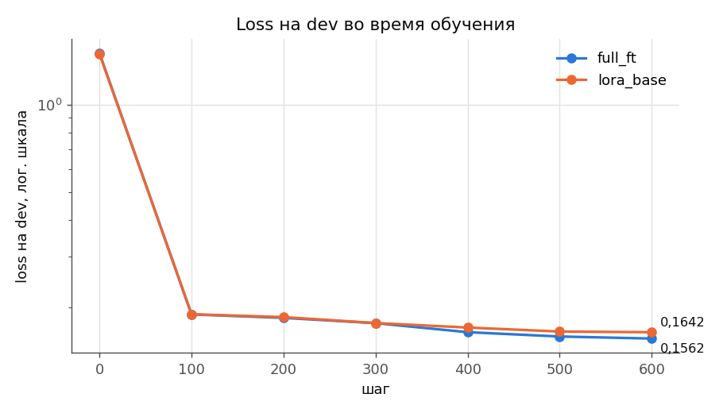
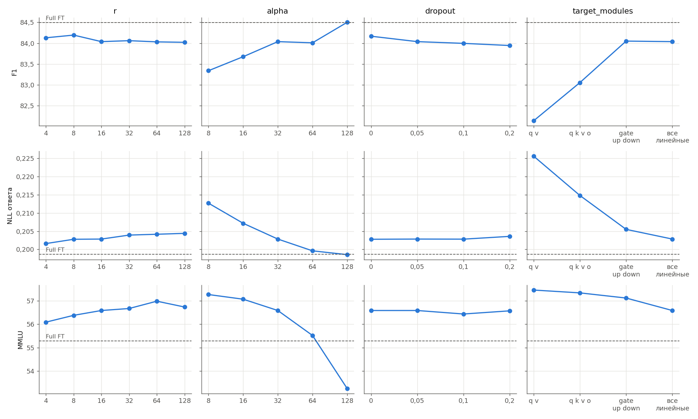
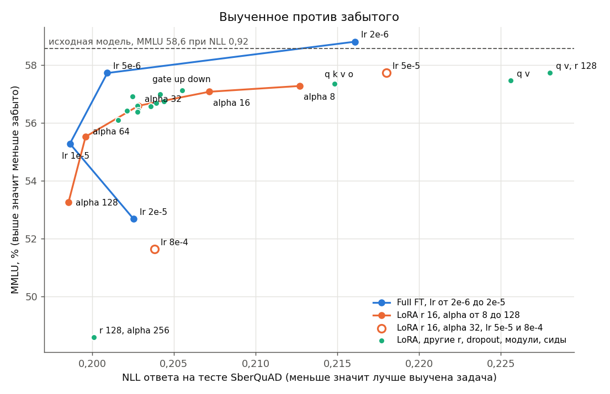

# Домашнее задание 4. Full fine-tuning и LoRA

Дообучала Qwen2.5-1.5B-Instruct отвечать на вопросы по тексту на русском (датасет SberQuAD) двумя способами, полным fine-tuning и LoRA. Всего сделала 28 обучений на одной A100 80GB. Это два основных прогона, 19 экспериментов с параметрами LoRA, 2 повтора Lora с другим сидом, 3 прогона full FT с другим lr и 2 замера памяти.

## Итог

| модель | обучаемых параметров | EM | F1 | NLL ответа | MMLU | время обучения | пик памяти |
|---|---|---|---|---|---|---|---|
| исходная | | 9,9 | 44,6 | 0,923 | 58,6 | | |
| Full FT, lr 1e-5 | 1544 млн (100 %) | 64,1 | 84,5 | 0,199 | 55,3 | 7,1 мин | 62,8 ГБ |
| LoRA r 16, alpha 32 | 18,5 млн (1,2 %) | 63,2 | 84,0 | 0,203 | 56,6 | 8,3 мин | 49,2 ГБ |
| Full FT, lr 5e-6 | 1544 млн (100 %) | 64,1 | 84,5 | 0,201 | 57,7 | 7,1 мин | 62,8 ГБ |

EM, F1 и MMLU указаны в процентах. EM и F1 считала на 5000 тестовых вопросах SberQuAD, MMLU на всех 14 042 вопросах. NLL ответа показывает, насколько модель уверена в правильном ответе и чем меньше, тем лучше. Если переобучить Lora с другим сидом, EM меняется в пределах 0,7, а MMLU в пределах 0,5, так что более мелкие различия можно считать шумом.

- Задачу обе модели выучили одинаково хорошо. EM вырос с 10 до 63 и 64, F1 с 45 до 84. Вместо пересказа модель теперь отвечает коротким куском текста.
- С обычными настройками LoRA забывает меньше, MMLU у нее падает на 2,0 пункта, а у full FT на 3,3. Но если подобрать lr, full FT выигрывает и тут. При одинаковом качестве на задаче он теряет на MMLU примерно на 2 пункта меньше. Лучшая модель это full FT с lr 5e-6, у нее MMLU всего на 0,8 ниже исходной.
- Обе модели стали отвечать коротко на любые вопросы. На просьбу поздравить коллегу пишут "С днем рождения!". MMLU этого не замечает, видно только при ручной проверке.
- Из параметров Lora сильнее всего влияет alpha. Ранг и dropout почти ни на что не влияют. Важно, в какие слои ставить адаптеры, лучше всего работают слои MLP.
- Lora обучает в 84 раза меньше параметров, и результат весит 70 МБ вместо 2,9 ГБ. Памяти она экономит 22 % без gradient checkpointing и в 3,5 раза меньше с ним. Но по скорости на этой модели Lora даже медленнее full FT.
- Для этой задачи на A100 лучше full FT. LoRA имеет смысл, если мало памяти или нужно держать много задач на одной базовой модели.

## 1. Датасет

Выбрала вариант А, готовый датасет [SberQuAD](https://huggingface.co/datasets/kuznetsoffandrey/sberquad) ([статья](https://arxiv.org/abs/1912.09723)). Это русский аналог SQuAD, около 50 тысяч вопросов к абзацам Википедии, и ответ на каждый вопрос это кусок абзаца.

Почему он
- Понятная задача, отвечать на вопрос по найденному тексту нужно в любом RAG.
- Качество проверяется автоматически по EM и F1, без LLM судьи.
- Исходной модели есть чему учиться. Ответ лежит непосредственно в тексте, но модель отвечает целым предложением, поэтому EM у нее всего 10 %.
- Ответы короткие, в среднем 10 токенов, поэтому проверка на 5000 вопросах занимает пару минут. Благодаря этому получилось сделать много экспериментов.

Примеры

| текст (начало) | вопрос | ответ |
|---|---|---|
| Союзные поставки очень неравномерно распределялись по годам войны. После нападения Японии на США 7 декабря 1941 поставки по ленд-лизу были приостановлены… | Когда Япония напала на США? | 7 декабря 1941 |
| Бабочки являются наиболее популярной группой насекомых для частных коллекционеров и научных работников. Это объясняется огромным количеством видов, большим разнообразием форм, их широким распространением… | Чем объясняется популярность бабочек как группы насекомых? | большим разнообразием форм, их широким распространением |

Разметка немного шумная, примерно в 18 % ответов краудсорсер поменял регистр или пунктуацию. Поэтому перед сравнением ответы привожу к одному виду.

**Разбиение.** У части test нет ответов, а все абзацы из validation есть и в train. Поэтому я объединила train и validation и поделила заново по абзацам, чтобы тексты из теста модель не видела при обучении. Для обучения взяла случайные 20 тысяч вопросов из 44 863. На всех данных один прогон шел бы около 20 минут, задача же выучивается уже за первые 100 шагов. Все модели учились и проверялись на одних и тех же данных, id вопросов лежат в [data/split_ids.json](data/split_ids.json).

| часть | вопросов | абзацев | зачем |
|---|---|---|---|
| test | 5000 | 893 | итоговые метрики |
| dev | 501 | 90 | loss во время обучения |
| train | 20 000 | 7689 | обучение |

**Формат.** Пример выглядит как диалог, пользователь дает текст и вопрос, ассистент отвечает. Loss считается только на ответе. Исходная модель на тесте получает такой же промпт.

```
<|im_start|>user
Прочитай текст и ответь на вопрос. Ответ должен быть точным фрагментом текста, без пояснений.

Текст: Соглашение о постепенном отказе от пограничного контроля было подписано 14 июня 1985 года … аналогичное
законодательство об отмене паспортного контроля к тому времени уже применялось странами Бенилюкса.

Вопрос: Какими странами ранее было принято аналогичное законодательство об отмене паспортного контроля?<|im_end|>
<|im_start|>assistant
странами Бенилюкса<|im_end|>
```

## 2. Метрики

**SberQuAD, качество на самой задаче.** Модель генерирует ответ, я сравниваю его с эталоном без учета регистра и пунктуации.
- EM это доля ответов, которые совпали с эталоном полностью.
- F1 засчитывает частичное совпадение по словам, что честнее по отношению к исходной модели, которая отвечает предложением с правильным ответом внутри.
- NLL ответа это loss на правильном ответе, как при обучении. Он почти не шумный, поэтому по нему лучше видны мелкие различия между настройками.

**MMLU, проверка на забывание.** Это 14 042 вопроса с выбором из четырех вариантов по 57 предметам на английском. Ответом считаю букву с самым большим логитом, без генерации. Тест далек от нашей задачи, поэтому если он проседает, значит модель что-то забыла. По нему отчитываются почти все модели, у базовой Qwen2.5-1.5B в [отчете Qwen](https://arxiv.org/abs/2412.15115) 60,9, у Instruct модели в моей постановке 58,6.

**Ручная проверка.** 10 одинаковых примеров для всех моделей, 6 вопросов из теста и 4 обычные просьбы, например объяснить, что такое фотосинтез. По просьбам видно, может ли модель еще отвечать развернуто.

## 3. Как обучала

| параметр | значение |
|---|---|
| данные | 1 эпоха по 20 000 примеров, батч 32, 625 шагов |
| оптимизатор | AdamW, weight decay 0, клиппинг градиента 1,0 |
| lr | cosine, warmup 3 % шагов |
| точность | bf16 autocast, FlashAttention 2 |
| батч | без паддинга, примеры склеены в одну строку |

| | Full FT | LoRA |
|---|---|---|
| что обучается | все 1,54 млрд весов | адаптеры, 18,5 млн (1,2 %) |
| веса | fp32 копия, вычисления в bf16 | база заморожена в bf16, адаптеры в fp32 |
| lr | 1e-5 | 2e-4 |
| r, alpha, dropout | | 16, 32, 0,05 |
| target_modules | | все линейные слои (q k v o gate up down) |

Full FT учит fp32 копию весов, потому что в чистом bf16 мелкие шаги Adam теряются при округлении. У LoRA lr больше, это обычная практика.

Еще одна оптимизация. TRL по умолчанию считает логиты по всему словарю (152 тысячи токенов) для каждого токена в батче, хотя loss нужен только на ответе, а это примерно 12 токенов из 350. Я переписала подсчет loss так, чтобы логиты считались только на ответе (AnswerLogitsTrainer в [train.py](train.py)). Loss от этого не меняется, зато full FT с батчем 32 перестал вылетать по памяти.

## 4. Исходная модель, full FT и LoRA

| модель | EM | F1 | NLL ответа | MMLU | loss на dev в конце | длина ответов на просьбы, символов |
|---|---|---|---|---|---|---|
| исходная | 9,9 | 44,6 | 0,923 | 58,6 | 1,50 (до обучения) | 497 |
| Full FT | 64,1 | 84,5 | 0,199 | 55,3 | 0,156 | 32 |
| LoRA | 63,2 | 84,0 | 0,203 | 56,6 | 0,164 | 110 |



Почти все обучение проходит за первые 100 шагов, loss на dev падает с 1,50 до 0,19 у обеих моделей. Дальше у full FT он снижается чуть быстрее.

Что поменялось в ответах. Исходная модель пишет в среднем 12 слов, и в двух третях вопросов правильный ответ спрятан у нее внутри длинного предложения. После обучения обе модели в 98 % случаев отвечают точным куском текста, в среднем 3,7 слова, как в эталоне. Совсем мимо только 5 % ответов. Остальные ошибки в основном в границах ответа, например "Реки Чороха" вместо "Чороха". В SberQuAD на вопрос один эталон, и границы часто спорные, так что часть ошибок это вероятно особенность разметки.

### Ручная проверка

Одни и те же 10 примеров, полные ответы лежат в [results/manual_eval.md](results/manual_eval.md).

| # | запрос | эталон | исходная | Full FT | LoRA |
|---|---|---|---|---|---|
| 1 | Как называется работа по сопоставлению с уже известными источниками, мысленной достройки…? | реконструктивной | Реконструктивная работа. | Реконструктивной работой | Реконструктивная работаТакже реконструктивная работа |
| 2 | В каком году была создана программа Аттестации бизнес- и конференц-отелей? | в 2012 году | В 2012 году была создана программа Аттестации… | в 2012 году | в 2012 году |
| 3 | Как в случае классификации по форме немецкие теоретики различают виды Д.? | Д. характеров и Д. положения | …различают Д. по характерам и положениям, смотря по тому, чем объясняются речи… | характеров и Д. положения | Д. характеров и Д. положения |
| 4 | Что проводят с целью углубленного понимания денежно-кредитной политики…? | новаторские исследования | Экономисты Федеральный резервный банк Бостона проводят новаторские исследования… | новаторские исследования | новаторские исследования |
| 5 | С течением какой реки примерно совпадает северная граница Малой Азии? | Чороха | У берегов Малой Азии расположены острова (Кипр, Родос и др.). | Чороха | Реки Чороха |
| 6 | Кто стал первым заместителем председателя правления банка Русский Стандарт с 12 ноября? | Александр Григорьев | Александр Григорьев | Александр Григорьев | Александр Григорьев |
| 7 | Объясни простыми словами, что такое фотосинтез. | | развернутый ответ в 6 шагов, с ошибками | одна фраза | одна фраза |
| 8 | Напиши короткое поздравление коллеге с днем рождения. | | поздравление в три предложения | С днем рождения! | С днем рождения! |
| 9 | У Маши было 5 яблок, она отдала 2 брату и купила еще 4. Сколько яблок у Маши? Объясни решение. | | решение по шагам, ответ 7 | 5-2+4=7 | 5 - 2 + 4 = 7 |
| 10 | Give three tips for learning a new language. | | три развернутых совета | 1. Practice regularly. | три коротких совета |

- **Вопросы по тексту (с 1 по 6).** Исходная модель знает ответ в пяти случаях из шести, но дословно ответила только в одном, в остальных пересказывает. Full FT и LoRA ответили точно в четырех случаях из шести, остальные ответы почти правильные. По задаче методы не различаются.
- **Обычные просьбы (с 7 по 10).** Тут видна цена дообучения. Исходная модель отвечает развернуто, а обе дообученные отвечают в пару слов на все подряд и не объясняют решение, хотя их об этом просят. Full FT пострадал сильнее, вместо трех советов дает один. Средняя длина ответа упала с 497 символов до 32 у full FT и до 110 у LoRA.

MMLU такое не ловит, потому что смотрит только на одну букву ответа. Поэтому я добавила в таблицы длину ответов на эти 4 просьбы. Грубая оценка, но она сходится с MMLU, чем сильнее упал MMLU, тем короче ответы.

### Ресурсы

| | Full FT | LoRA |
|---|---|---|
| обучаемых параметров | 1543,7 млн (100 %) | 18,5 млн (1,2 %) |
| время обучения | 7,1 мин | 8,3 мин |
| скорость | 17,0 тыс. токенов в секунду | 14,6 тыс. токенов в секунду |
| пик памяти | 62,8 ГБ | 49,2 ГБ |
| пик памяти с gradient checkpointing | 25,0 ГБ | 7,1 ГБ |
| размер результата | 2,9 ГБ | 70 МБ |
| генерация на 5000 вопросах | 99 с | 156 с (адаптер не слит с весами) |

**Память.** У full FT веса, градиенты и состояние Adam в fp32 занимают 23 ГБ, у LoRA около 3 ГБ. Но без gradient checkpointing больше всего памяти уходит на активации, и они нужны обоим методам, поэтому разница всего 13,6 ГБ. С checkpointing активаций становится гораздо меньше, и LoRA занимает в 3,5 раза меньше памяти. Full FT этой модели не влезет в карту на 24 ГБ даже с checkpointing, а LoRA влезет.

**Скорость.** LoRA не считает градиенты для замороженных весов, это экономит примерно треть вычислений. Но PEFT на каждый из 196 адаптеров делает лишние операции, копирует вход в fp32, применяет dropout и делает два маленьких умножения. На модели такого размера это съедает всю экономию. Без dropout LoRA быстрее на 9 %, а адаптеры только на q и v работают на треть быстрее full FT. На инференсе адаптер лучше слить с весами, иначе генерация в 1,6 раза медленнее.

## 5. Параметры LoRA

В каждом эксперименте меняла один параметр относительно базовой конфигурации (r 16, alpha 32, dropout 0,05, все линейные слои, lr 2e-4). Еще сделала две комбинации, две проверки lr и два повтора с другим сидом.

| что меняем | r | alpha | dropout | модули | lr | параметров, млн | EM | F1 | NLL | MMLU | длина ответов | время, мин | пик, ГБ |
|---|---|---|---|---|---|---|---|---|---|---|---|---|---|
| база | 16 | 32 | 0,05 | все | 2e-4 | 18,5 | 63,2 | 84,0 | 0,203 | 56,6 | 110 | 8,3 | 49,2 |
| r | 4 | 32 | 0,05 | все | 2e-4 | 4,6 | 63,6 | 84,1 | 0,202 | 56,1 | 110 | 8,4 | 49,0 |
| r | 8 | 32 | 0,05 | все | 2e-4 | 9,2 | 63,5 | 84,2 | 0,203 | 56,4 | 113 | 8,2 | 49,0 |
| r | 32 | 32 | 0,05 | все | 2e-4 | 36,9 | 63,7 | 84,1 | 0,204 | 56,7 | 104 | 8,2 | 49,5 |
| r | 64 | 32 | 0,05 | все | 2e-4 | 73,9 | 63,3 | 84,0 | 0,204 | 57,0 | 54 | 8,3 | 50,2 |
| r | 128 | 32 | 0,05 | все | 2e-4 | 147,7 | 63,2 | 84,0 | 0,204 | 56,7 | 114 | 8,4 | 51,4 |
| alpha | 16 | 8 | 0,05 | все | 2e-4 | 18,5 | 62,6 | 83,3 | 0,213 | 57,3 | 258 | 8,3 | 49,2 |
| alpha | 16 | 16 | 0,05 | все | 2e-4 | 18,5 | 63,0 | 83,7 | 0,207 | 57,1 | 114 | 8,3 | 49,2 |
| alpha | 16 | 64 | 0,05 | все | 2e-4 | 18,5 | 63,6 | 84,0 | 0,200 | 55,5 | 90 | 8,3 | 49,2 |
| alpha | 16 | 128 | 0,05 | все | 2e-4 | 18,5 | 64,4 | 84,5 | 0,199 | 53,2 | 40 | 8,3 | 49,2 |
| dropout | 16 | 32 | 0 | все | 2e-4 | 18,5 | 63,3 | 84,2 | 0,203 | 56,6 | 111 | 7,6 | 42,5 |
| dropout | 16 | 32 | 0,1 | все | 2e-4 | 18,5 | 63,1 | 84,0 | 0,203 | 56,4 | 106 | 8,3 | 49,2 |
| dropout | 16 | 32 | 0,2 | все | 2e-4 | 18,5 | 63,1 | 83,9 | 0,204 | 56,6 | 113 | 8,3 | 49,2 |
| модули | 16 | 32 | 0,05 | q v | 2e-4 | 2,2 | 60,5 | 82,1 | 0,226 | 57,5 | 262 | 5,3 | 32,7 |
| модули | 16 | 32 | 0,05 | q k v o | 2e-4 | 4,4 | 61,8 | 83,1 | 0,215 | 57,3 | 238 | 5,9 | 36,0 |
| модули | 16 | 32 | 0,05 | gate up down | 2e-4 | 14,1 | 63,7 | 84,1 | 0,205 | 57,1 | 113 | 7,1 | 42,5 |
| комбинация | 128 | 32 | 0,05 | q v | 2e-4 | 17,4 | 60,3 | 82,0 | 0,228 | 57,7 | 258 | 5,4 | 33,1 |
| комбинация | 128 | 256 | 0,05 | все | 2e-4 | 147,7 | 63,3 | 83,9 | 0,200 | 48,6 | 31 | 8,4 | 51,4 |
| lr | 16 | 32 | 0,05 | все | 5e-5 | 18,5 | 61,3 | 82,7 | 0,218 | 57,7 | 280 | 8,3 | 49,2 |
| lr | 16 | 32 | 0,05 | все | 8e-4 | 18,5 | 63,1 | 83,6 | 0,204 | 51,6 | 30 | 8,3 | 49,2 |
| сид 1 | 16 | 32 | 0,05 | все | 2e-4 | 18,5 | 63,6 | 84,3 | 0,202 | 56,9 | 112 | 8,3 | 50,2 |
| сид 2 | 16 | 32 | 0,05 | все | 2e-4 | 18,5 | 63,9 | 84,4 | 0,202 | 56,4 | 216 | 8,3 | 50,7 |

Для сравнения full FT с разным lr

| Full FT, lr | EM | F1 | NLL | MMLU | длина ответов |
|---|---|---|---|---|---|
| 2e-6 | 62,1 | 83,3 | 0,216 | 58,8 | 277 |
| 5e-6 | 64,1 | 84,5 | 0,201 | 57,7 | 50 |
| 1e-5 | 64,1 | 84,5 | 0,199 | 55,3 | 32 |
| 2e-5 | 63,2 | 83,4 | 0,203 | 52,7 | 45 |

Три сида одной и той же конфигурации расходятся на 0,7 по EM, 0,4 по F1 и 0,5 по MMLU, поэтому выводы делаю в основном по NLL и MMLU.



Пунктир на графиках это full FT с lr 1e-5.

**r.** Ранг от 4 до 128 почти ничего не меняет, F1 около 84 при любом r, хотя параметров становится в 32 раза больше. Даже r 4 хватает, видимо для такой задачи нужное изменение весов простое. С ростом r модель учит чуть меньше и чуть меньше забывает, потому что при фиксированном alpha множитель alpha / r уменьшается (об этом пишут в [rsLoRA](https://arxiv.org/abs/2312.03732)). Если вместе с r увеличить и alpha (r 128, alpha 256), задачу модель учит лучше, но MMLU падает на 10 пунктов, это самое сильное забывание из всех экспериментов. На память и время ранг почти не влияет, растет только размер адаптера, с 18 до 564 МБ.

**alpha.** Самый сильный параметр, по сути он работает как множитель шага обучения. Чем больше alpha, тем лучше выучена задача и тем сильнее забывание. При alpha 8 NLL 0,213 и MMLU 57,3, а при alpha 128 NLL 0,199 как у full FT, но MMLU всего 53,2, и ответы на обычные просьбы сжимаются до 40 символов. Изменение lr дает похожий эффект, но не один в один, lr 8e-4 хуже alpha 128 по обоим показателям. Так что alpha и lr лучше подбирать вместе.

**dropout.** На качество не влияет, все различия в пределах шума. Dropout нужен против переобучения, а за одну эпоху модель видит каждый пример один раз и переобучиться не успевает. Зато без dropout обучение на 9 % быстрее и требует на 6,7 ГБ меньше памяти, так что тут лучше ставить 0.

**target_modules.** Второй по силе параметр, чем больше слоев с адаптерами, тем лучше. Только q и v дают F1 82,1, все внимание 83,1, только MLP 84,1, все слои 84,0. Главное здесь MLP, с ним одним качество уже как у всех слоев. Дело не в количестве параметров. Адаптеры на q и v с r 128 по числу параметров почти равны всем слоям с r 16, но работают так же плохо, как q и v с r 16. Хороший компромисс это только MLP, качество как у всех слоев, MMLU чуть выше, а обучение на 14 % быстрее.

## 6. Финальный анализ



Каждая точка на графике это одна модель. Чем левее, тем лучше выучена задача, чем выше, тем меньше забыто. Исходная модель на уровне пунктира, но далеко справа (NLL 0,92).

**Качество**
- С обычными настройками full FT чуть лучше учит задачу, а LoRA меньше забывает. Это совпадает со статьей Бидермана (https://arxiv.org/abs/2405.09673) "LoRA learns less and forgets less".
- Но если менять lr у full FT и alpha у LoRA, видно, что при одинаковом качестве на задаче full FT забывает меньше, примерно на 2 пункта MMLU. То есть LoRA меньше забывает просто потому, что меньше учится. 
- Лучшая модель это full FT с lr 5e-6. Качество на задаче как у лучших моделей, а MMLU всего на 0,8 ниже исходной.
- Проблема у обоих методов общая, модели начинают отвечать коротко на все подряд. Это лечится данными, например можно добавить в обучение обычные инструкции. Способ дообучения тут не поможет.

**Затраты**
- LoRA обучает в 84 раза меньше параметров, адаптер весит 70 МБ вместо 2,9 ГБ, поэтому на одной базовой модели можно держать много адаптеров.
- По памяти без checkpointing разница всего 22 %, с checkpointing уже в 3,5 раза.
- По времени LoRA на этой модели не быстрее, а даже медленнее full FT, 8,3 минуты против 7,1.

**Вывод.** Для этой задачи на A100 80GB лучше full FT с подобранным lr. Он учит задачу не хуже, меньше портит модель и работает быстрее, а 63 ГБ памяти помещаются на карту. LoRA стоит выбирать, если памяти мало, если нужно много задач на одной базе или если модель нужно изменить как можно меньше. Для LoRA на этой задаче я бы взяла r 8 или 16, dropout 0, адаптеры на все линейные слои или только на MLP и alpha 32 или 64 при lr 2e-4.

**Ограничения.** Обучение шло одну эпоху на 20 тысячах примеров. Сиды повторяла только для базовой LoRA. Длину ответов посчитала всего по четырем просьбам.

## Как запустить

Нужны A100 80GB, Python 3.12 и драйвер с поддержкой CUDA 12.6.

```bash
python3 -m venv venv && venv/bin/pip install -r requirements.txt
venv/bin/python common.py                # разбиение данных
./run.sh 0 base full_ft lora_base        # исходная модель, full FT и LoRA на GPU 0
./run.sh 1 lora_r4 lora_alpha8 lora_qv   # любые эксперименты из train.py на GPU 1
venv/bin/python make_report.py           # таблицы и графики
```

Метрики пишутся в results/NAME.json, ответы на тесте в results/predictions, веса в outputs. Команда SMOKE=1 ./run.sh 0 lora_base проверяет, что все работает.

## Файлы

- [common.py](common.py), промпт, разбиение данных и метрики
- [train.py](train.py), все конфигурации и обучение
- [eval_model.py](eval_model.py), оценка моделей
- [run.sh](run.sh), запуск экспериментов по очереди
- [make_report.py](make_report.py), таблицы и графики
- [results/](results/), метрики всех прогонов, ответы на тесте, таблицы и графики
